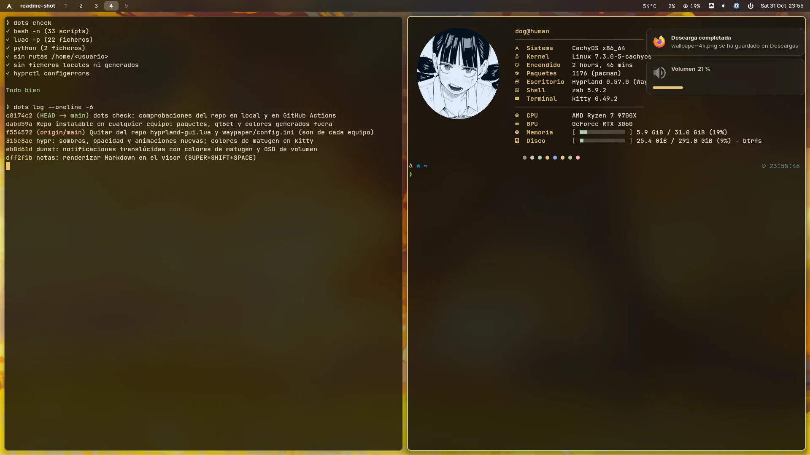
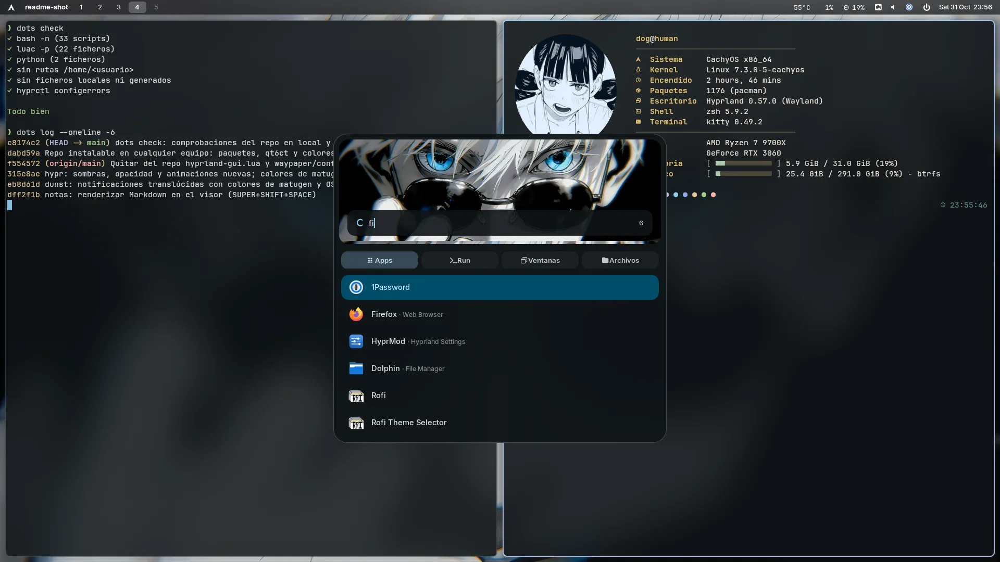

# dotfiles

Hyprland (config en Lua) en CachyOS, con estética macOS Sequoia en oscuro. Los colores de todo
el sistema salen del fondo de pantalla (matugen), así que cambian con cada fondo:




| Qué | Dónde |
|---|---|
| Hyprland: atajos, reglas, autostart, dock, Alt+Tab | `.config/hypr/` |
| Barra de menú y dock auto-ocultable (waybar) | `.config/waybar/` |
| Fondos (waypaper + mpvpaper, imágenes y vídeo) | `.config/waypaper/config.example.ini` |
| Notificaciones translúcidas y aviso de volumen (dunst) | `.config/dunst/`, `.config/hypr/scripts/volume.sh` |
| Colores del sistema a partir del fondo (matugen) | `.config/matugen/` |
| Lanzador (tema Aurora) y menú de apagado (rofi) | `.config/rofi/` |
| Centro de control (reloj de waybar) y selector de fondos en cinta (Super+Shift+W), con Quickshell | `.config/quickshell/` |
| Neovim (LazyVim) | `.config/nvim/` |
| Tema "Nocturne" para Brave | `.local/share/brave-themes/nocturne/` |
| Tema "Nocturne" para LibreWolf | `.config/librewolf/librewolf/*/chrome/`, `user.js` |
| Shell (zsh + Powerlevel10k) y fastfetch con avatar al abrir kitty | `.zshrc`, `.p10k.zsh`, `.config/fastfetch/`, `.config/kitty/` |
| Activar Secure Boot con claves propias (sbctl + GRUB) | `secureboot.sh` |

## Dependencias

```sh
sudo pacman -S hyprland waybar quickshell rofi kitty fastfetch dolphin waypaper mpvpaper socat matugen \
  ffmpeg jq grim slurp wl-clipboard libnotify brightnessctl playerctl wireplumber dunst hyprsunset xdg-desktop-portal-hyprland \
  inter-font ttf-jetbrains-mono-nerd papirus-icon-theme imagemagick python-pillow python-numpy neovim shellcheck lua
```

## Instalación rápida

```sh
curl -fsSL https://raw.githubusercontent.com/PabloGarPe/dotfiles/main/.github/install.sh | bash
```

[`.github/install.sh`](install.sh) instala los paquetes de arriba (y Brave, LibreWolf y `cachyos-zsh-config` si están en tus repos) y clona el repo bare en `~/.dotfiles`. Antes del checkout, mueve a `~/.dotfiles-backup/<fecha>/` los ficheros que ya tengas y vayan a sobrescribirse. También pone zsh como shell y copia el tema de LibreWolf a tu perfil. Si lo vuelves a ejecutar, solo hace `pull`. Opciones (tras `bash -s --`):

| Opción | Qué hace |
|---|---|
| `--no-deps` | no instala paquetes |
| `--sddm [tema]` | instala los temas de SDDM y activa `crimson-moon` (o `six-eyes`) |
| `--nvim` | descarga los plugins de Neovim y los LSPs de Go, C/C++ y Rust |

```sh
curl -fsSL https://raw.githubusercontent.com/PabloGarPe/dotfiles/main/.github/install.sh | bash -s -- --sddm --nvim
```

## Instalación manual (repo bare)

```sh
git clone --bare git@github.com:PabloGarPe/dotfiles.git ~/.dotfiles
alias dots='git --git-dir=$HOME/.dotfiles --work-tree=$HOME'
dots config status.showUntrackedFiles no
dots checkout   # si choca con ficheros existentes, muévelos antes
```

Sin el instalador, haz a mano lo que él hace después del checkout:

```sh
cp ~/.github/exclude ~/.dotfiles/info/exclude
dots config alias.check '!bash "$HOME/.github/check.sh"'
cp ~/.config/waypaper/config.example.ini ~/.config/waypaper/config.ini
sed "/^#/d; s|@HOME@|$HOME|g" ~/.config/qt6ct/qt6ct.example.conf > ~/.config/qt6ct/qt6ct.conf
matugen color hex "#8caaee" -m dark   # colores iniciales, hasta que elijas un fondo
```

## Qué no está en el repo

[`.github/exclude`](exclude) lista lo que `dots add` nunca debe meter:

- **Ficheros de cada equipo:** `.config/hypr/hyprland-gui.lua` (ajustes de HyprMod, como los monitores) y `.config/waypaper/config.ini` (fondo elegido). El segundo sale de `config.example.ini`.
- **Colores generados por matugen** (`colors.lua`, `colors.css`, `matugen.rasi`, `kitty/matugen.conf`, el prompt de zsh…): cambian con cada fondo. Las plantillas están en `.config/matugen/templates/`; el instalador los genera la primera vez y, a partir de ahí, se regeneran al elegir fondo con waypaper.
- **`qt6ct.conf`:** necesita rutas absolutas, así que se genera desde `qt6ct.example.conf`.

El tema de Brave se carga a mano: `brave://extensions` → modo desarrollador → *Cargar descomprimida* → `~/.local/share/brave-themes/nocturne`.

## Secure Boot

`secureboot.sh` activa Secure Boot en CachyOS con GRUB y dual boot con Windows, usando claves propias firmadas con `sbctl` (sin shim). Incluye las claves de Microsoft, así que Windows y los Option ROMs de la GPU siguen arrancando. Se hace en tres pasos, con visitas a la BIOS entre medias:

```sh
./secureboot.sh prepare   # instala sbctl, copia el ESP a /root y reinstala GRUB con los módulos integrados
# BIOS: borrar las claves de Secure Boot (Setup Mode), sin activarlo todavía
./secureboot.sh enroll    # crea y registra las claves (+ Microsoft) y firma GRUB y los kernels
# BIOS: activar Secure Boot (OS Type: "Windows UEFI mode")
./secureboot.sh check     # comprueba el estado y que todo está firmado
```

Los ficheros firmados quedan en la base de datos de `sbctl`, y su hook de pacman los vuelve a firmar en cada actualización del kernel o de GRUB.

## Uso

```sh
dots status
dots add .config/hypr/conf/keybinds.lua
dots commit -m "..."
dots check   # comprobaciones antes de subir
dots push
```

`dots check` ([`.github/check.sh`](check.sh)) revisa la sintaxis de los scripts (bash, shellcheck, Lua, Python), que no haya rutas con un usuario concreto (`/home/<usuario>`) ni ficheros excluidos dentro del repo y, si estás en Hyprland, que la config cargue sin errores. GitHub Actions lo ejecuta en cada push.
